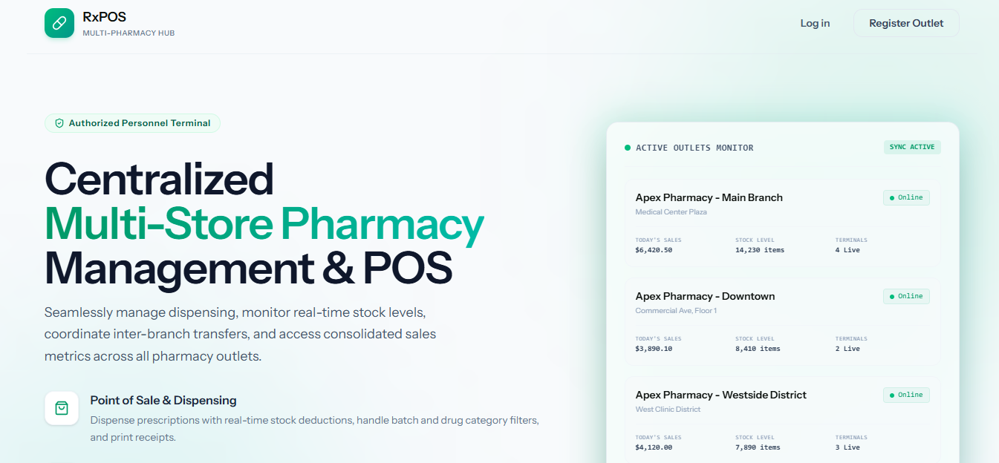
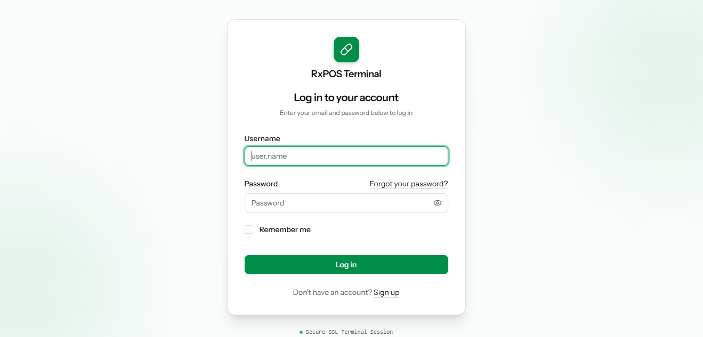
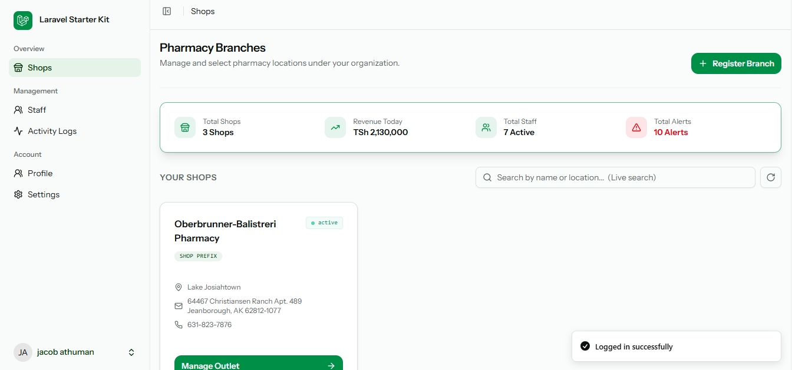
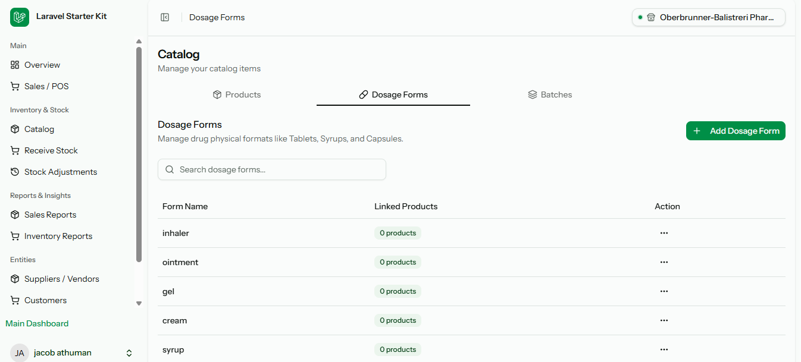

# Pharmacy Inventory & POS System with AI (v1)

> A multi-shop pharmacy point-of-sale and inventory management platform built with Laravel 13, React 19 and Inertia v3 — with batch and expiry tracking, sales/stock reporting, role-based access, and audit trails. AI-assisted forecasting is planned for a later release (see [Future Roadmap](#-future-roadmap)).

## 📌 Project Overview

Pharmacy management demands strict compliance, precise stock tracking, and real-time point-of-sale efficiency. Traditional retail systems often lack specialized inventory controls for medications (such as batch/lot tracking, expiry enforcement, and regulated dispensing workflows), leading to stock shrinkage, compliance risks, and stockout penalties.

**Pharmacy Inventory & POS System with AI (v1)** bridges this gap with a monolithic full-stack application: a Laravel backend and a React/Inertia SPA. This release focuses on dependable day-to-day operations — checkout with expiry-sorted batch selection, expiry and low-stock alerts, reports, staff/shop management, and activity logs. AI-driven demand forecasting is on the roadmap rather than implemented in v1.

## 🖼️ Visuals & Interface

> _Note: Screen captures highlighting UI component interactions, role-based interfaces, and overall workflow execution._

|                 Landing Page                  |
| :-------------------------------------------: |
|  |

|                Login Page                 |
| :---------------------------------------: |
|  |

|                   Admin Dashboard                   |
| :-------------------------------------------------: |
|  |

|                    Employee Dashboard                     |
| :-------------------------------------------------------: |
|  |

### Architectural Blueprint

```
                      ┌─────────────────────────────────────────┐
                      │          Browser / Web Client           │
                      │  React 19 + Inertia v3 + Tailwind v4    │
                      └────────────────────┬────────────────────┘
                                           │  Inertia Protocol (JSON over HTTP)
                                           ▼
                      ┌─────────────────────────────────────────┐
                      │             Laravel 13 App              │
                      │  ┌───────────────────────────────────┐  │
                      │  │ Controllers / Services /          │  │
                      │  │ Middleware / Policies / Enums     │  │
                      │  └─────────────────┬─────────────────┘  │
                      └────────────────────┼────────────────────┘
                                           │
                   ┌───────────────────────┴───────────────────────┐
                   ▼                                               ▼
      ┌────────────────────────┐                      ┌────────────────────────┐
      │    Relational DB       │                      │  Reporting & auditing  │
      │  MySQL 8 (local) /     │                      │  SQL aggregates,       │
      │  SQLite (tests)        │                      │  Spatie Activity Log   │
      └────────────────────────┘                      └────────────────────────┘
```

## ⚙️ Core Features

- **Point of Sale (POS) Terminal**: Search the catalogue by product or dosage form, pick from expiry-sorted batches, manage the cart, validate the final total server-side, and print receipts.

- **Batch & Expiry-Aware Inventory**: Batch numbers, manufacturing and expiry dates, expiry-sorted batches in the POS catalogue (the cashier selects the batch), stock adjustments with movement history, and configurable low-stock/expiry thresholds.

- **Reports & Insights**: Sales, profit and top-product reports, inventory valuation, low-stock and expiry summaries, with period and custom date-range filters.

- **Transactional Integrity**: Explicit database transactions with row locks around checkout, batch stock decrements, sale creation, stock movements, and audit records.

- **Role-Based Access Control (RBAC)**: Spatie roles (`admin`, `manager`, `cashier`) and permissions, plus shop-membership middleware that scopes managers and cashiers to their assigned branches. Admins can access every shop.

- **Audit Trails**: Spatie Activity Log records catalogue, stock, sales, staff, and shop actions with causer/subject/shop context, browseable through organisation-wide and per-shop log views.

- **Accounts & Settings**: Laravel Fortify authentication and password reset, account status handling (active/inactive/suspended), and profile, security, and appearance settings.

## 🛠️ Tech Stack & Architecture

| Category                  | Technology                          | Usage / Purpose                                                      |
| ------------------------- | ----------------------------------- | -------------------------------------------------------------------- |
| **Backend Framework**     | Laravel 13.x                        | Routing, authentication, business logic, Eloquent ORM, queues        |
| **Frontend Framework**    | React 19.x + TypeScript             | Component-driven, typed UI rendering                                 |
| **Glue Layer**            | Inertia.js v3 + Wayfinder           | SPA visits without a custom API, typed route helpers                 |
| **Styling Framework**     | Tailwind CSS v4 + Radix UI          | Utility-first responsive design and accessible components            |
| **Auth & Permissions**    | Laravel Fortify + Spatie Permission | Login/password reset, roles, permissions, shop-scoped access         |
| **Audit Logging**         | Spatie Activity Log                 | Searchable activity history for admin and shop contexts              |
| **Database**              | MySQL 8 (local), SQLite (tests)     | ACID-compliant relational storage, constraints, and indexes          |
| **Runtime & Environment** | PHP 8.3+ / Laravel Herd             | Local development; developed on PHP 8.5                              |
| **Build Tooling**         | Vite 8 + npm                        | HMR during development and production asset builds                   |
| **Version Control**       | Git / GitHub                        | Feature branching and structured commit isolation                    |

## 📐 Technical & Engineering Highlights

- **Inertia v3 SPA Architecture**: Server-driven props and typed route helpers (Wayfinder) keep business logic on the server while retaining client-side interactivity and prefetching.

- **Expiry-Sorted Batch Selection**: POS queries exclude expired/out-of-stock batches and order the rest by expiry date; the client submits the chosen `batch_id`, while checkout validates shop ownership and available units and locks batch rows to prevent overselling.

- **Explicit Transactions**: Manual transaction blocks with rollback paths cover checkout, stock adjustments, catalogue writes, and staff/shop management; receipt numbering uses `lockForUpdate()`.

- **Indexed & Constrained Schema**: UUIDs on domain models, composite unique keys (for example, one batch number per product per shop), and a `(shop_id, product_id, expiry_date)` index for fast FEFO lookups.

- **Integrated Activity Logging**: Domain actions log causer, subject, shop, and before/after values, exposed through filterable admin and shop log screens.

## 🚀 Local Setup & Installation

### Prerequisites

Ensure you have the following installed on your machine:

- **PHP** (>= 8.3; the project is developed on PHP 8.5)

- **Composer**

- **Node.js** (`^20.19.0 || >=22.12.0`, required by Vite 8) & **npm**

- **MySQL** (>= 8.0), or a database managed through Laravel Herd. Tests use in-memory SQLite, so no MySQL instance is needed for the test suite.

### Quick Start Guide

1. **Clone the Repository**

    ```bash
    git clone https://github.com/zui-xgit/pharmacy-inventory-pos-system-with-AI-V1.git
    cd pharmacy-inventory-pos-system-with-AI-V1
    ```

2. **Install Dependencies**

    ```bash
    # Install PHP dependencies
    composer install

    # Install Node dependencies
    npm install
    ```

    Alternatively, `composer setup` performs dependency installation, `.env` creation, key generation, migration, and the production asset build in one command.

3. **Environment Configuration**

    ```bash
    cp .env.example .env
    php artisan key:generate
    ```

    Uncomment and adjust the MySQL block in `.env` (create the database first):

    ```env
    DB_CONNECTION=mysql
    DB_HOST=127.0.0.1
    DB_PORT=3306
    DB_DATABASE=pharmacy-inventory-pos-system-with-AI
    DB_USERNAME=root
    DB_PASSWORD=
    ```

    `.env.example` also contains commented SQLite and PostgreSQL examples.

4. **Database Setup**

    ```bash
    # Run migrations and seed roles, permissions, a demo admin, and two sample shops
    php artisan migrate --seed
    ```

5. **Run the Development Server**

    - **Laravel Herd (recommended on macOS/Windows):** the site is already served at `http://pharmacy-inventory-pos-system-with-ai-v1.test`. Start the asset watcher for hot reloading:

      ```bash
      npm run dev
      ```

    - **Plain PHP server:**

      ```bash
      php artisan serve

      # In a separate terminal, start Vite for hot module replacement (HMR)
      npm run dev
      ```

6. **Access the Application**

    Open `http://127.0.0.1:8000` when using `php artisan serve`, or the Herd URL above.

    The seeder creates an admin account with username `admin.admin` and password `123456789`. Change this password before using the application for anything other than local development.

### Tests & Code Quality

```bash
php artisan test          # PHPUnit suite (in-memory SQLite)
composer lint             # Laravel Pint
composer types:check      # PHPStan / Larastan
npm run lint:check        # ESLint
npm run types:check       # TypeScript
npm run format:check      # Prettier
```

> Some legacy tests still assert an older schema (for example `sales.user_id`) and currently fail. Treat these as known gaps rather than regressions in the current application code.

## 🔮 Future Roadmap

- [ ] **AI-Assisted Demand Forecasting**: Connect an AI service to historical sales data for demand forecasts and reorder recommendations (no AI integration exists in v1).

- [ ] **Barcode / SKU Scanning**: Add SKU/barcode fields and scanner-driven lookup to the POS catalogue.

- [ ] **Automated Supplier API Integration**: Direct electronic purchase order transmission to pharmaceutical suppliers upon low-stock alerts.

- [ ] **Offline-First Cashier Sync**: Service Worker integration for local offline sales queueing and seamless background synchronization when connection resumes.

- [ ] **Advanced Audit Trails**: Immutable audit logging for controlled substance tracking and regulatory audit export (PDF/CSV).

## 👤 Author & Contact

**Bernard Benetson Mbeikya**

_Full-Stack Engineer | Computer Science Professional_

- **GitHub**: [zui-xgit](https://github.com/zui-xgit)

- **Email**: [benardbenny90@gmail.com](mailto:benardbenny90@gmail.com)

- **Mobile / WhatsApp**: [+255 767 798 494](https://wa.me/255767798494)
